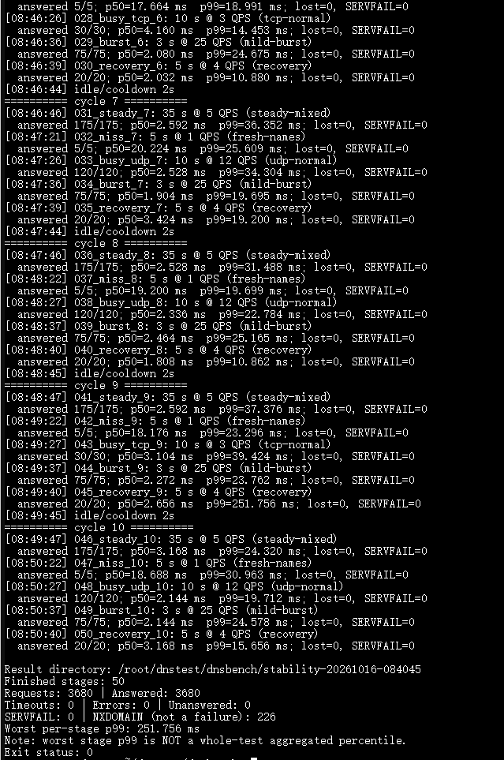
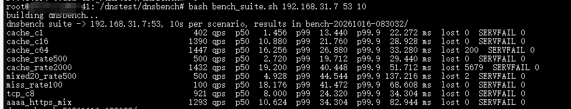
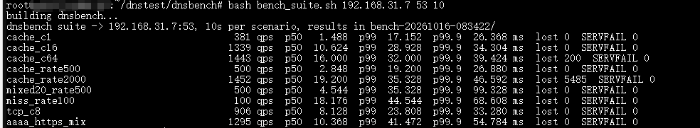

# DNS 长时间稳定性与适度突发测试

> 本文档由 AI 整理生成。

本指南说明仓库中两个**不同用途**的 Linux 测试脚本。所有压测都应仅针对自己管理或已获授权的 DNS 服务器进行。

## 1. 两份脚本的区别

| 脚本 | 用途 | 强度 |
|---|---|---|
| `tools/dnsbench/bench_suite.sh` | 10 秒各类吞吐、并发与 500/2000 QPS 目标压力测试 | **高压**，可能导致上游限速和设备超时 |
| `tools/dnsbench/dns_stability_test.sh` | 5～10 分钟日常流量＋轻度短突发、恢复观察 | **温和**，默认 5 / 12 / 25 QPS 分阶段 |

## 2. Linux 编译测试工具

在仓库根目录：

```bash
sudo apt update
sudo apt install -y build-essential python3
cc -O2 -pthread -o tools/dnsbench/dnsbench.bin tools/dnsbench/dnsbench.c -lm
```

或使用项目 Linux CMake 测试目标，具体见 [BENCHMARK](BENCHMARK.md)。若当前工作目录正好是 `tools/dnsbench`，可以运行：

```bash
cc -O2 -pthread -o dnsbench.bin dnsbench.c -lm
DNSBENCH="$PWD/dnsbench.bin" bash dns_stability_test.sh 192.168.31.7 53 600
```

注意 `DNSBENCH` 必须指向**实际存在且可执行的二进制文件**，不是同名目录；路径不存在时会得到 `No dnsbench executable found`。检查：`ls -l "$DNSBENCH"`。

## 3. 测试前准备

1. 让测试机通过稳定的有线局域网连接路由器，ESP32-S3 Wi-Fi 信号尽量固定；勿同时改变上游、AP 信道和过滤列表。
2. 先用 `dig @设备IP example.com A`、`dig @设备IP example.com A +tcp` 检查 UDP/TCP DNS。
3. 保证大型订阅更新不在默认基准运行时意外启动；如果要测试**规则更新与 DNS 并发**，应专门标注启动规则更新的时刻。
4. 高频 `miss` 请求依赖真实上游，有上游 QPS 限流或计费风险；`.invalid` 名称可能在设备上被本地处理，不保证真的发送到上游。
5. 用多次实验的中位数比较版本，并记录 ESP-IDF、固件、Wi-Fi RSSI、AP、上游、过滤列表和缓存大小。

## 4. 5 分钟 / 10 分钟指令

```bash
# 在仓库根目录运行
DNSBENCH="$PWD/tools/dnsbench/dnsbench.bin" \
  bash tools/dnsbench/dns_stability_test.sh 192.168.31.7 53 300

# 10 分钟
DNSBENCH="$PWD/tools/dnsbench/dnsbench.bin" \
  bash tools/dnsbench/dns_stability_test.sh 192.168.31.7 53 600
```

可选降低轻突发强度：

```bash
BASE_QPS=3 BURST_QPS=15 \
DNSBENCH="$PWD/tools/dnsbench/dnsbench.bin" \
bash tools/dnsbench/dns_stability_test.sh 192.168.31.7 53 600
```

## 5. 默认场景（每轮约 60 秒）

| 阶段 | 参数 | 含义 |
|---|---|---|
| 常态 | 35 秒、5 QPS | 混合请求，验证典型响应延迟 |
| 新域名 | 5 秒、1 QPS | 少量缓存未命中/随机名称测试 |
| 繁忙 | 10 秒、12 QPS（每 3 轮为 TCP 3 QPS） | 多设备同时查询及 TCP 连接路径 |
| 突发 | 3 秒、25 QPS | 短时适度冲击，优先重复热名称 |
| 恢复 | 5 秒、4 QPS | 观察突发后延迟是否回落 |
| 间歇 | 2 秒、0 QPS | 减少持续挤压上游 |

以上默认值在脚本内由环境变量控制；可运行 `bash tools/dnsbench/dns_stability_test.sh --help` 查看确切可调范围。**限制客户端发送 QPS 并不能确保 ESP32 的真实上游请求也相同：并行上游策略、重试、其他终端和缓存未命中会额外增加负载。**

## 6. 已有一次 600 秒样本（2026-10-16）

| 指标 | 结果 |
|---|---|
| 测试目标 | `192.168.31.7:53` |
| 测试时长 | 600 秒、10 轮、50 个阶段 |
| 请求 / 应答 | **3,680 / 3,680** |
| 超时、未应答、其他错误 | **0** |
| SERVFAIL | **0** |
| NXDOMAIN | **226**，这是 DNS 响应码，不等于请求失败 |
| 25 QPS 突发 | 每轮 75 请求，10 轮共 **750/750** 应答 |
| 突发各轮 p99 | **12.09–41.434ms** |
| 恢复阶段偶发尾部峰值 | 第 9 轮 p99 **251.756ms**（该阶段只有 20 请求） |
| 结论 | 在这次受控条件下完整执行且无丢失；并不能据此宣称硬件无故障或所有场景稳定 |

样本数量较少的阶段里 p99 可能几乎由最慢的一次查询决定。`worst per-stage p99` 是所有阶段 p99 的最大值，**不是 3,680 次查询合并后的全局 p99**。一次 251ms 峰值不能直接归咎于 Wi-Fi、上游或 ESP32 任务调度；应结合查询日志进一步定位。



## 7. 原始高并发基准结果及使用警告

`bench_suite.sh` 10 秒基准测试：

| 场景 | 成功 QPS | p50 (ms) | p99 (ms) | 丢失 |
|---|---:|---:|---:|---:|
| cache_c1 | 402 | 1.456 | 13.440 | 0 |
| cache_c16 | 1,390 | 10.880 | 21.760 | 0 |
| cache_c64 | 1,447 | 16.256 | 26.880 | 200 |
| cache_rate500 | 500 | 2.720 | 19.712 | 0 |
| cache_rate2000 | 1,432 | 19.200 | 40.448 | 5,679 |
| mixed20_rate500 | 500 | 4.928 | 44.544 | 2 |
| miss_rate100 | 100 | 18.176 | 41.472 | 0 |
| tcp_c8 | 921 | 8.000 | 24.320 | 0 |
| aaaa_https_mix | 1,293 | 10.624 | 34.304 | 0 |





**原版 `bench_suite.sh` 会冲击 2,000 QPS 目标且某些场景含不限速预热**，所以测试前先了解上游限速和影响范围。已经观察到该高压场景的大量丢失，不适宜长时间在共享 DNS 上持续执行。

## 8. 输出与排障

稳定性脚本会生成 `stability-YYYYmmdd-HHMMSS/`，包含阶段 JSON、`summary.csv`、`final_summary.txt`。重点看：0 丢包、SERVFAIL、p50/p99、恢复阶段是否反复出现高尾部延迟、ESP32 是否有看门狗复位或规则更新失败。

如果需要对比版本，建议先做三轮常态 10 分钟测试，再单独测试“规则更新中保持 DNS 查询”的路径，完整记录 Flash GC 是否导致查询毛刺。**不要简单把 10 分钟稳定性称为 24×7 验证。**
